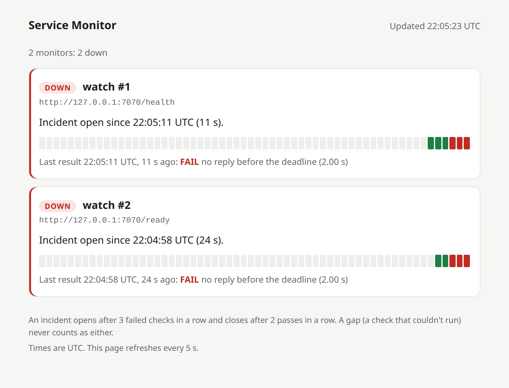
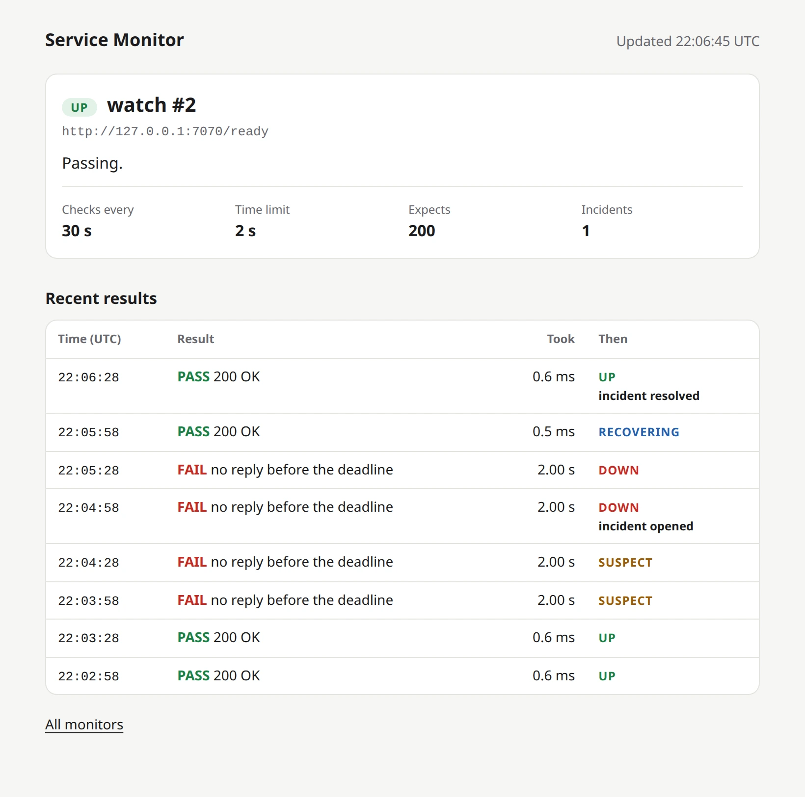

+++
title = "Checkpoint 1.3: a dashboard that admits when it doesn't know"
description = "My monitor now has a web page: every check, live, with no JavaScript. It also says STALE when its own data is too old to trust, because a frozen dashboard showing green is worse than no dashboard."
date = 2026-10-14T23:00:00Z

[extra]
# experiment, failure or release
kind = "experiment"
milestone = "M1"
step = "1.3"
short_title = "A dashboard that admits when it doesn't know"
# Rust tests in the workspace at this checkpoint (the home page draws them as a sparkline).
tests = 168

[extra.summary]
goal = "Watch the monitor work in a browser, and never show a state the evidence doesn't support."
built = "A live dashboard served by the monitor itself: HTML written in Rust, plain CSS, no JavaScript."
proof = ["incident opened 75 s after a real hang, closed 45 s after the fix", "168 tests, 10/10 clean runs", "137 planted bugs: 9 slipped through at first, 0 now"]
code = "1ad4e85"
+++

The scariest dashboard isn't the one showing red. It's the one that froze an hour ago, still showing green, while nobody notices.

So this step gave my monitor a web page, with one rule above all the others: when the page doesn't know, it says so.

## What I built

**A dashboard, served by the monitor itself.** Add `--dashboard-port 7171` and open `http://127.0.0.1:7171/` in a browser. For every monitor it shows:

- its state, with one plain sentence on why ("Failing: 2 of 3 failures in a row before an incident opens");
- the last 60 results as a row of little bars: green passed, red failed, grey couldn't check;
- the last result, and how long ago it came in.

Click a monitor's name for its own page: its settings and its last 120 results, newest first, with the moments an incident opened and closed.

**No JavaScript at all.** The page is plain HTML and CSS, written in Rust, and it simply reloads itself every 5 seconds. Nothing to install, nothing to build, nothing that can break in your browser.

## How it works (the short version)

**The page reads a photo, never the live state.** After every check, the monitor takes a "photo" of everything it knows and pins it up. The page reads the newest photo. It's like a scoreboard operator who hands out printed copies instead of letting people read over his shoulder: however many people are looking, nobody can slow down the person keeping score. Rust makes the photo cheap. The check results inside it are shared, never copied.

**Old news is labelled as old news.** Every monitor has a freshness limit: two check intervals plus the time limit plus 5 seconds (130 s for a check every minute with a 5-second time limit). If the newest real result is older than that, the badge says **STALE** and the sentence says the last state can't be trusted. A dashboard that freezes can't quietly keep showing green.

**It only talks to your own computer.** There's no login yet, so the page listens only on 127.0.0.1 and answers only requests addressed to `127.0.0.1` or `localhost`. That second part blocks a sneaky trick called DNS rebinding, where a website points its own name at your computer to read pages that were only meant for you. It also only reads: anything other than looking at a page gets a polite "no".

## Does it actually work?

I pointed it at the Node.js app from [checkpoint 1.1](@/service-monitor/checkpoint-1-1.md), checking `/health` and `/ready` every 30 seconds, and ran the same incident as last time: at 22:03:43 the app hangs (it accepts requests but never answers), and two minutes later it's fixed. The dashboard was open the whole time.

Here it is, about 100 seconds into the hang:

<figure class="shot">
  <picture>
    <source srcset="down-phone-dark.webp" width="780" height="1376" media="(max-width: 600px) and (prefers-color-scheme: dark)">
    <source srcset="down-phone-light.webp" width="780" height="1376" media="(max-width: 600px)">
    <source srcset="down-desktop-dark.webp" width="1640" height="1252" media="(prefers-color-scheme: dark)">
    
  </picture>
  <figcaption>Both checks have failed three times in a row, so both incidents are open. Each bar is one check.</figcaption>
</figure>

And here's `/ready`'s own page once it's all over. Read it from the bottom up: two passes, two suspicious failures, the incident opening on the third failure, one more failure while the app still hangs, then recovering, and resolved.

<figure class="shot">
  <picture>
    <source srcset="history-phone-dark.webp" width="780" height="1928" media="(max-width: 600px) and (prefers-color-scheme: dark)">
    <source srcset="history-phone-light.webp" width="780" height="1928" media="(max-width: 600px)">
    <source srcset="history-desktop-dark.webp" width="1640" height="1626" media="(prefers-color-scheme: dark)">
    
  </picture>
  <figcaption>The whole incident in one table, newest first.</figcaption>
</figure>

`/ready` opened its incident 75 seconds after the hang and closed it 45 seconds after the fix: the same to the second as in [checkpoint 1.2](@/service-monitor/checkpoint-1-2.md), and in all three runs of today's demo.

**Behind the pictures:** 168 tests, including 12 that talk to the dashboard over real network connections and check every rule above. Wrong address: refused. Anything but reading: refused. A visitor who connects and says nothing: cut off after the time limit.

I also let a tool plant 137 small bugs in the new code. 9 slipped through at first, and most of them were the page's own words: you could blank out "PASS" or the "Updated" time, and every test still passed. Those words are what a person actually reads, so now the tests check them exactly. All 9 are caught.

## Where I messed up

**I almost shipped a server with no time limits.** The web framework I use (axum) comes with a ready-made server, and its own building block (hyper) has a 30-second limit for a visitor to say what they want. But hyper quietly drops that limit unless it's given a clock, and axum's ready-made server never gives it one. Someone could connect, say nothing, and hold the line forever.

So the dashboard has its own small server: 10 seconds to send a request (and an idle connection closes after 10 seconds too), a limit of 32 connections at once, and when the server stops, every connection stops with it. I tested each part by breaking it on purpose: without the clock, 4 tests failed; let connections outlive the server, and the shutdown test failed; drop the connection limit, and the limit test failed.

**My design preview went STALE on its own.** To design the page without waiting for real outages, I wrote a preview with seven made-up monitors, one in every state. One of them was meant to look stale. A few minutes later, three more said STALE too. My made-up data was frozen at startup, and the freshness rule did exactly its job. The preview now replays its data against the current time. Best bug report I've had all day.

**One of my tests said "A or B".** I wasn't sure how the page would write an apostrophe, so a test accepted either version. One version could never happen, so the test was weaker than it looked. And a vague check right next to it was hiding an awkward sentence: "Couldn't check (couldn't look: blocked by the network policy)". The tests now check exact sentences, and the page says "Couldn't check: blocked by the network policy."

## What it doesn't do yet

- **No login,** so it only works on the computer running the monitor. A login comes before it's ever reachable from anywhere else.
- **It can't change anything.** Adding or editing monitors from the page comes later (M4).
- **It forgets everything on restart.** Saving history is the next milestone (M2).
- **No limit on how many checks run at once yet.** That's the last step of M1.

## Up next

**Checkpoint 1.4: a fair queue for checks.** Limits on how many checks run at once, overall and per website, so a hundred monitors never stampede the network or one struggling site.
