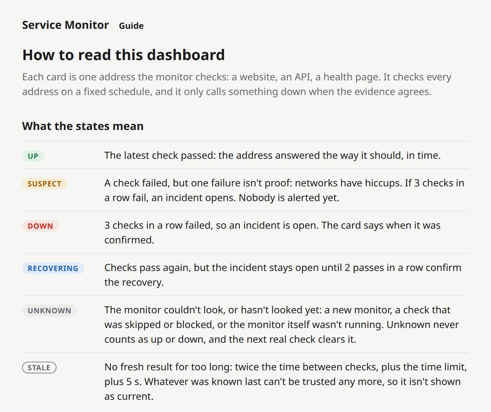

+++
title = "Checkpoint 2.2: a dashboard that explains itself"
description = "My dashboard now has a Guide page that explains every colour and word in plain English, and the project has a proper README. Both are checked against the real program, so neither can quietly go out of date."
date = 2026-10-15T23:00:00Z

[extra]
# experiment, failure or release
kind = "experiment"
milestone = "M2"
step = "2.2"
short_title = "A dashboard that explains itself"
# Rust tests in the workspace at this checkpoint (the home page draws them as a sparkline).
tests = 235

[extra.summary]
goal = "Anyone can read the dashboard without asking me what anything means."
built = "A Guide page in the dashboard, a README with real output for every command, and tests that keep both in step with the program."
proof = ["every guide row lined up to 0.00 px on phone and desktop", "235 tests, 10/10 clean runs; the README checked against --help", "25 planted bugs: 24 caught, 1 didn't compile"]
code = "b054c28"
+++

Show my dashboard to someone who has never used a monitor, and they'll see shouty capital letters and a row of tiny coloured bars. SUSPECT? Of what? STALE, like bread?

Every one of those words means something precise. This step makes sure the dashboard says what, right there, in plain English.

## What I built

**A Guide page, one click from everywhere.** Every dashboard page now has a "Guide" link next to the name. The Guide explains:

- what each state means (UP, SUSPECT, DOWN, RECOVERING, UNKNOWN, STALE);
- what the coloured bars are;
- when an incident opens and closes, and why the opening time isn't the moment the problem started;
- every reason a bar can be grey, word for word as the dashboard writes it;
- why a check can start a little late;
- and what the monitor never does, like showing green without proof.

<figure class="shot">
  <picture>
    <source srcset="guide-phone-dark.webp" width="780" height="2256" media="(max-width: 600px) and (prefers-color-scheme: dark)">
    <source srcset="guide-phone-light.webp" width="780" height="2256" media="(max-width: 600px)">
    <source srcset="guide-desktop-dark.webp" width="1600" height="1344" media="(prefers-color-scheme: dark)">
    
  </picture>
  <figcaption>The top of the Guide, from the dashboard's design preview.</figcaption>
</figure>

**It stays still.** The other pages reload themselves every 5 seconds, so they always show the latest. The Guide doesn't. A page that reloads while you're reading it loses your place.

**A proper README.** For whoever installs the monitor: a quick start, every command with its options and a real example of what it prints, what every exit code means, and a troubleshooting table with every message the program can show and what to do about it.

## How it works (the short version)

**The Guide can't fall out of date by accident.** Its words come from the same code that writes the dashboard's words. The sentence it quotes for a skipped check *is* the sentence the dashboard prints. And every state has to have an explanation: if I add a new state one day and forget to write one, the program won't even build, and a test checks that every state is on the page.

**The numbers come from the rules.** "3 checks in a row", "at most 2 per site", "within 5 seconds": none of these are typed into the text. They're read from the same settings the monitor uses, so if a rule changes, the explanation changes with it.

**The README is checked against the real program.** A test runs every command's built-in help and compares it with the README: every option, every default value, every exit code, every usage line. To make sure that test actually bites, I planted four kinds of mistakes in the README (a wrong default, an option that doesn't exist, a missing option, a wrong exit code). It caught all four.

## Does it actually work?

**Measured, not eyeballed.** I opened the Guide in a real browser (headless Chrome) at phone and desktop width, in light and dark mode, and measured the layout:

- every state's badge sits on exactly the same line as its explanation: **0.00 px** off, in all four;
- every sample bar is centred on the first line of its text, to the same 0.00 px;
- the "Guide" link sits on the same baseline as the name;
- nothing scrolls sideways, and nothing pokes past the edge of the screen.

**Behind it:** 235 tests, 10 clean runs of the whole suite in a row. A tool planted 25 small bugs in the new code: 24 were caught, and 1 didn't compile.

On the first run, 2 slipped through, and it was a mistake I'd made before. A test was checking the sentences next to each bar colour, but it got the "right answer" from the very code it was testing. So if that code changed its words, the test changed its answer too, and still passed. It's like marking your own homework with your own answer sheet. The sentences are now written out in the test itself.

## Where I messed up

**A "5 s" I'd typed by hand.** When a check is skipped, the dashboard says it "couldn't start within 5 s". That 5 was typed straight into the sentence. If the rule ever changed, the dashboard would have quietly told you the wrong number. Writing the Guide made me look, and now the number comes from the rule itself.

**One lonely little bar.** My first Guide showed a single sample bar next to each colour's explanation. In a column wide enough for "RECOVERING", one tiny bar looked lost, with a big empty gap before its text. Now each row shows six bars, like a slice of the real strip, and fills the column.

**The Guide link nudged the clock down a line on phones.** On a 390-pixel phone screen, "Service Monitor", "Guide" and "Updated 16:05:50 UTC" don't all fit on one line any more, so the time drops to a second line. My measuring script flagged it (27 px). I looked, and on a phone it actually reads better, lined up under the name. I kept it, but on purpose this time.

## What it doesn't do yet

- **The README covers today's commands.** It grows with every step: updating the Guide and the README is now part of "done" for every checkpoint.
- **No pictures of a whole incident in the Guide.** Words only, for now.
- **English only.**

## Up next

**Checkpoint 2.3: monitors that survive a restart.** `watch --data-dir` remembers which websites it watches, with stable numbers and settings, so after a restart it picks up exactly where it left off.
