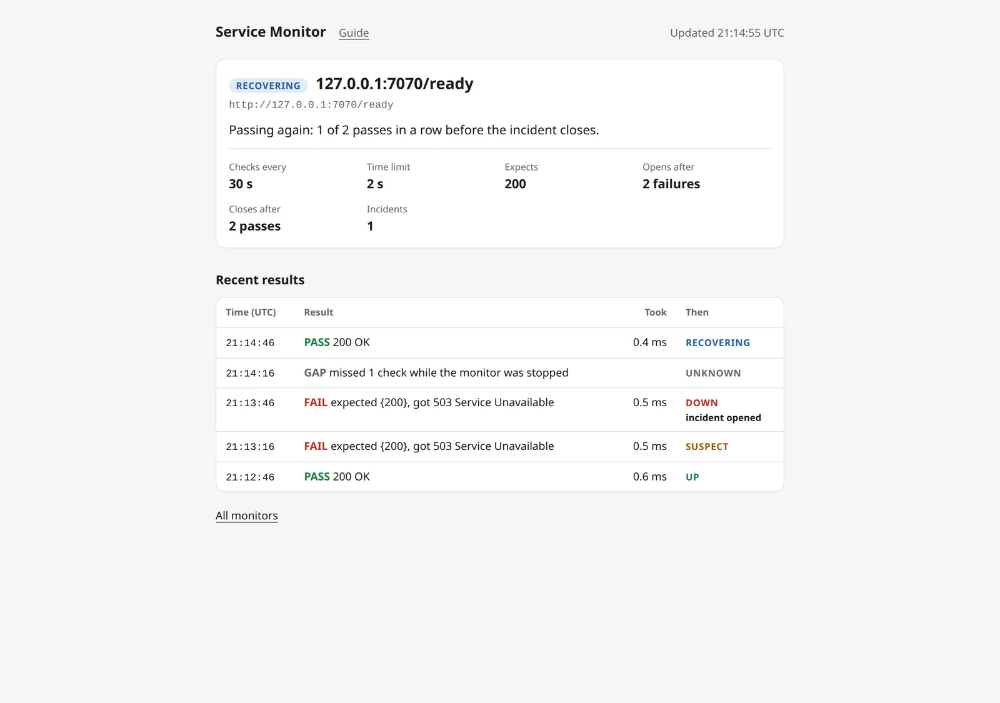

+++
title = "Checkpoint 2.5: restarts that don't lie"
description = "I killed my monitor in the middle of an outage, fixed the website while it was down, and started it again. It knew exactly what it had missed, kept the incident open, and refused to call it fixed after one good check."
date = 2026-10-16T05:00:00Z

[extra]
# experiment, failure or release
kind = "experiment"
milestone = "M2"
step = "2.5"
short_title = "Restarts that don't lie"
# Rust tests in the workspace at this checkpoint (the home page draws them as a sparkline).
tests = 321

[extra.summary]
goal = "After any restart, even a crash, the monitor knows what it missed and never pretends."
built = "A morning check before anything runs: cut-off checks and the downtime written down as gaps, open incidents kept open, history loaded back, the schedule resumed exactly."
proof = ["killed mid-incident by a real test and a live demo", "a million rows: back up in 74 ms from a cold disk", "every planted bug that compiled was caught, after 3 new tests"]
code = "2cc6edd"
+++

Picture a night guard who dozes off at 2 a.m. and wakes up at 3. There are two kinds of guard. One writes "all quiet" in the log for that hour. The other writes "asleep from 2 to 3: no idea what happened".

You want the second guard. Until now, my monitor couldn't even be the first one: after a restart, it simply started over, as if the time before had never happened.

The last step taught it to save everything. This step teaches it to **wake up honestly**.

## What I built

**A morning check, before anything runs.** When the monitor starts, it first looks at what the last run left behind, and puts it right:

- **A check that was cut off** (the monitor died while waiting for a website's answer) is written down as a gap: "the monitor stopped during the check". Nobody knows what that check would have said, so it doesn't count either way.
- **The time it wasn't running** becomes one gap per website: "missed 14 checks while the monitor was stopped". Its own downtime is never mistaken for the *website's* downtime.
- **An incident that was open stays open.** And here's the important bit: it needs *fresh* passes to close. One good check after a restart isn't proof of anything.

**Its memory comes back.** The dashboard shows the history from before the restart, every row with the state it led to, so a crash doesn't wipe the page clean. In the terminal, each website says what happened while the monitor was away:

```
#2 http://127.0.0.1:7070/ready  every 30 s, first check at 21:14:46 UTC (unchanged)
   since the last run: 1 check missed while stopped, kept as a gap; UNKNOWN until the next check
   last result before: 21:13:46 UTC FAIL expected {200}, got 503 Service Unavailable (DOWN)
   an incident is still open (confirmed 21:13:46 UTC): it closes after 2 passes in a row
```

**No catch-up storm.** A monitor that wakes up and fires every missed check at once is like a whole street ringing your doorbell at the same moment. Mine just carries on at the next check due, exactly where it left off, and never checks the same moment twice.

<figure class="shot">
  <picture>
    <source srcset="restart-phone-dark.webp" width="780" height="1886" media="(max-width: 600px) and (prefers-color-scheme: dark)">
    <source srcset="restart-phone-light.webp" width="780" height="1886" media="(max-width: 600px)">
    <source srcset="restart-desktop-dark.webp" width="1600" height="1125" media="(prefers-color-scheme: dark)">
    
  </picture>
  <figcaption>Ten seconds after the restart: the history from before the crash, the gap while it was down, and the first fresh pass. RECOVERING, not UP.</figcaption>
</figure>

## How it works (the short version)

**One gap, not ten thousand.** If the monitor is off for a week, that's one line in the history, not one per missed minute. The history stays readable, and the database stays small.

**Fast, even with a full week.** A week of checks for 100 websites, one a minute, is about a million rows. Starting up with all of that takes **74 ms** with nothing in memory (every page read from the disk), and **25 ms** when the data is already in memory. The trick is boring, which is the best kind: every question the monitor asks at startup goes through an index, like looking a word up at the back of a book instead of reading every page. A test checks that no startup question ever reads a whole table, and it fails if I delete one of those indexes.

**New settings count as a fresh start.** If you restart it with a different interval, the counting starts over (it's a different experiment now), but an open incident stays open.

## Does it actually work?

**I killed it, for real.** A test starts the real program against a website that's failing, waits for the incident to open, and pulls the plug (`SIGKILL`: no goodbye, no cleanup). While it's down, the website gets fixed. Then the test starts it again and checks everything: the failure from before survived; the missed check is one "monitor was stopped" gap, not an outage; the incident is still open; the first pass says RECOVERING (1 of 2); the second closes it; and there's exactly one incident in the database.

A second test kills it *in the middle of a check*, while it waits for an answer that never comes. After the restart, that check is a gap, and the dashboard says "the monitor stopped during the check".

**And again live**, against my little Node.js app, with the dashboard open. That's the screenshot above.

**The restart shows exactly what it showed before.** A random tester builds 128 different histories (passes, failures, gaps, incidents), restarts the monitor from the database, and compares, record by record, what the restarted monitor shows with what the original showed. Another one kills it at 256 random moments, and checks every time that each check has exactly one row and nothing is left half-written.

**Behind it:** 321 tests, 10 clean runs in a row. A tool planted 132 small bugs in the new code: 23 didn't compile, 100 were caught, and 9 slipped through. Six of those were harmless (two ways of writing the same thing), so I simplified the code until there was only one way. Three were real, and one of them is the next story. After the fixes, a second round planted 42 more: every one that compiled was caught.

## Where I messed up

**Two notebooks that disagreed.** The monitor keeps a little notebook of "when did this run of failures start?", so incidents know their first failure. The restored notebook and the live one disagreed in one corner: after an incident opened, the live one kept a time the restored one had no way to know. Nothing used it, so nothing broke. But two copies of the truth that quietly disagree are a bug waiting for its moment. The random tester found it on its 12th try. Now the incident takes those times with it, both notebooks agree, and the tester checks that they always will.

**A rule I almost skipped.** Re-reading the plan before committing, I found a corner: restart it *quickly* with new settings, before any check was missed, and the old counts would carry over into the new settings. The plan says new settings reset the counts. Now they do, with a test.

**A test that checked a look-alike.** My "every startup question uses an index" test first checked a query that *resembled* the real one. A test should check the thing itself, so now it asks about the exact statement the monitor runs. Deleting the index makes it fail.

**A restart that could have gone quiet for hours.** When the monitor restarts, it resumes at the exact moment it stopped: "next up, check number 500". But if you restart it with *new settings*, the counting starts over from zero, and "check number 500" in the new count is hours away. One line of code picked which number to use, and no test noticed when the planted bug flipped it, because in my quick restart test no time had passed, so both numbers happened to be 0. That choice is now its own little function, tested with a 500.

**"Kept as gaps"**, when there was one gap. Small, but the demo is where I saw it. Fixed.

## What it doesn't do yet

- **Old data is never deleted yet.** A week of checks is about 120 MB. Keeping a week and summing up the rest comes next.
- **No disk limits yet.** That's checkpoint 2.7.
- **Alerts** come in milestone 3.

## Up next

**Checkpoint 2.6: keeping a week, summing up the rest.** Raw checks kept for 7 days, hourly summaries kept for 90, and the summaries always written before the raw rows they summarise are deleted.
